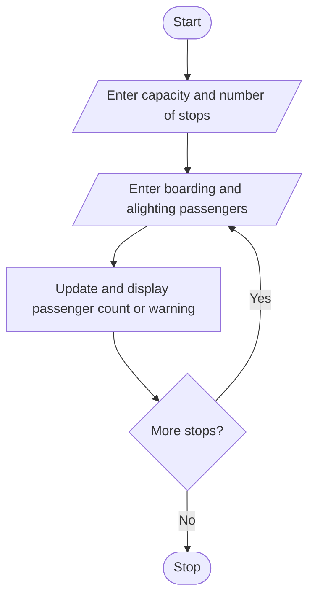

# Problem Statement
write a python program to process boarding and alighting counts across multiple stops, calculate passenger counts at each stop, and flag any capacity violations. 

# Algorithm

1. Start
2. Enter the bus capacity and number of stops.
3. At each stop, enter passengers boarding and alighting.
4. Update the passenger count and display it or a capacity warning.
5. Repeat for all stops.
6. Stop

# Flowchart

# Sample Input

Capacity: 40
Stops: 2
Stop 1: boarding 20, alighting 0
Stop 2: boarding 25, alighting 3

# Sample Output

Passengers at stop 1 : 20
Capacity exceeded at stop 2

