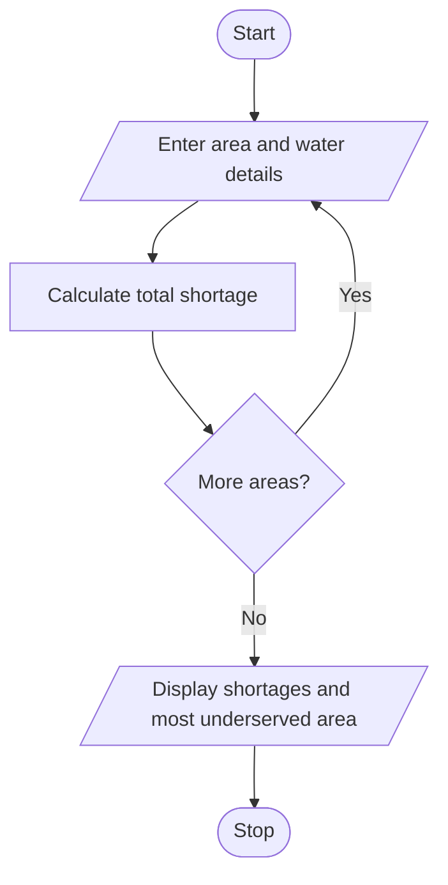

# Problem Statement
write a python program to analyse area-wise water supply across several days, calculate shortages against demand, compare distribution levels, and identify the most underserved areas. 

# Algorithm

1. Start
2. Enter the number of areas and days.
3. For each area, enter its daily demand and water supplied each day.
4. Calculate and sort the total shortages.
5. Display each shortage and the most underserved area.
6. Stop

# Flowchart

# Sample Input

Number of areas: 2
Number of days: 2
Area name: North
Daily water demand: 100
Water supplied on day 1: 80
Water supplied on day 2: 70
Area name: South
Daily water demand: 100
Water supplied on day 1: 90
Water supplied on day 2: 95

# Sample Output

North total shortage: 50.0
South total shortage: 15.0
Most underserved area: North

