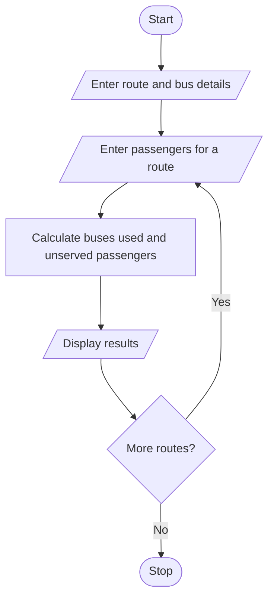

# Problem Statement

Write a program to determine the number of buses needed for several routes, account for bus capacities and passenger demand, and identify unserved passengers. 

# Algorithm

1. Start
2. Enter the number of routes, bus capacity, and maximum buses per route.
3. For each route, enter the passenger demand.
4. Calculate buses used and unserved passengers.
5. Display the results for each route.
6. Stop

# Flowchart

# Sample Input

Number of routes: 2
Passengers per bus: 40
Maximum buses per route: 3
Passengers on route 1: 100
Passengers on route 2: 150

# Sample Output

Buses used: 3
Unserved passengers: 0
Buses used: 3
Unserved passengers: 30

