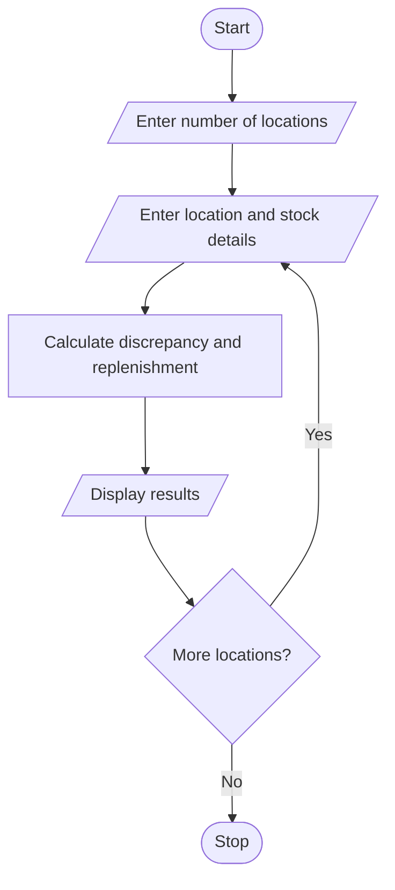

# Problem Statement

Write a program to compare quantities received, distributed, damaged, and remaining across several locations; identify discrepancies and calculate replenishment requirements. 

# Algorithm

1. Start
2. Enter the number of locations.
3. For each location, enter stock details.
4. Calculate expected stock, discrepancy, and replenishment.
5. Display the results.
6. Stop

# Flowchart

# Sample Input

Number of locations: 1
Location name: North
Quantity received: 100
Quantity distributed: 60
Quantity damaged: 5
Recorded remaining stock: 30
Minimum stock needed: 40

# Sample Output

North Discrepancy: -5 Replenish: 10

