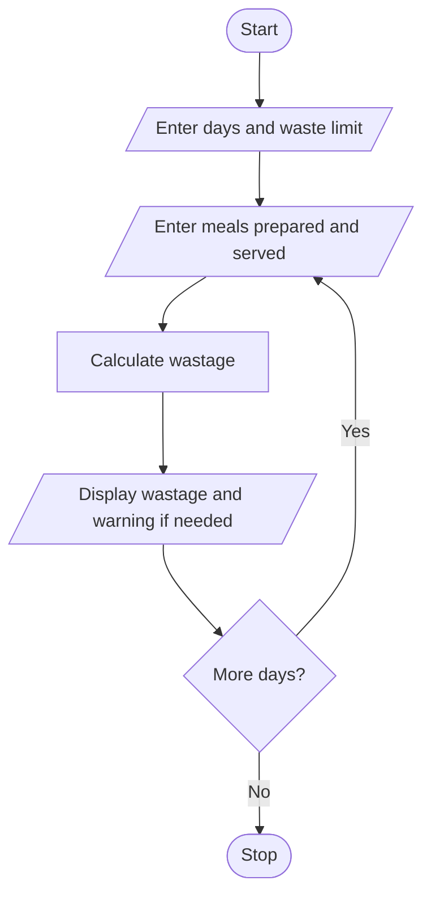

# Problem Statement

Write a program to compare prepared meals, meals served, and leftovers across several days; calculate wastage percentages and identify days exceeding acceptable limits

# Algorithm

1. Start
2. Enter the number of days and waste limit.
3. For each day, enter meals prepared and served.
4. Calculate and display wastage.
5. Display a warning if wastage exceeds the limit.
6. Stop

# Flowchart

# Sample Input

Number of days: 1
Maximum waste percentage: 10
Meals prepared: 100
Meals served: 85

# Sample Output

Wastage: 15.0%
Waste limit exceeded

