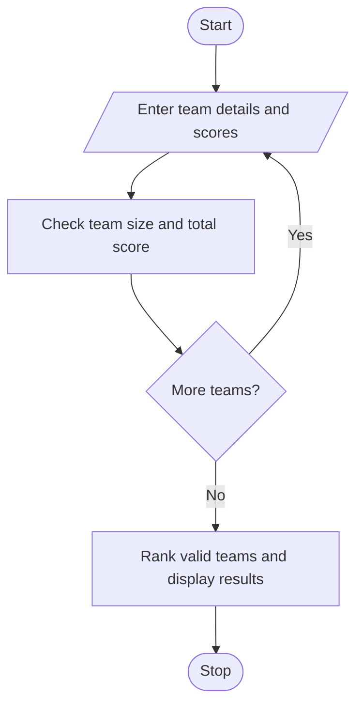

# Problem Statement

Write a program to analyse student scores and team compositions, validate team sizes, aggregate round-wise scores, and resolve tied rankings using predefined rules. 

# Algorithm

1. Start
2. Enter each team’s name, size, and three scores.
3. Accept teams with 2–5 members and calculate their total score.
4. Display an error for invalid team sizes.
5. Rank valid teams and display the results.
6. Stop

# Flowchart

# Sample Input

Number of teams: 1
Team name: Tigers
Number of members: 3
Round scores: 80, 90, 85

# Sample Output

1 Tigers Score: 255

