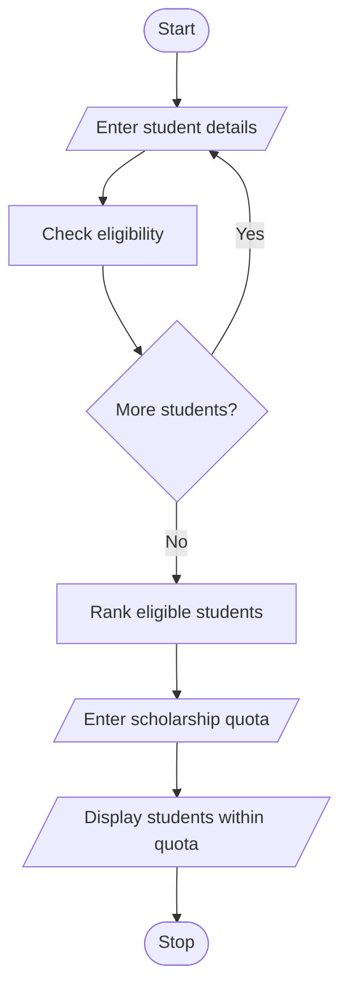

# Problem Statement

Write a program to apply minimum academic eligibility, attendance requirements, income conditions, and ranking rules to select candidates within a fixed scholarship quota. 

# Algorithm

1. Start
2. Enter student details.
3. Keep students with marks of at least 80, attendance of at least 75%, and income of no more than 500,000.
4. Sort eligible students and enter the scholarship quota.
5. Display students within the quota.
6. Stop

# Flowchart

# Sample Input

Number of students: 2
Name: Asha
Average marks: 90
Attendance percentage: 85
Family income: 400000
Name: Ravi
Average marks: 75
Attendance percentage: 80
Family income: 300000
Scholarship quota: 1

# Sample Output

1 Asha 90.0

