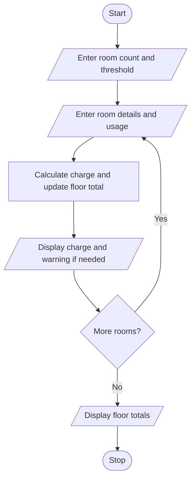

# Problem Statement

write a python program to analyse room-wise electricity and water consumption, calculate charges, identify threshold violations, and compare resource utilization across floors
# Algorithm

1. Start
2. Enter the number of rooms and usage threshold.
3. For each room, enter its floor, room number, electricity usage, and water usage.
4. Calculate and display the charge; show a warning if usage exceeds the threshold.
5. Add usage to the floor total.
6. Display usage totals by floor.
7. Stop

# Flowchart

# Sample Input

Number of rooms: 1
Usage threshold: 100
Floor: 1
Room number: 101
Electricity used: 10
Water used: 5

# Sample Output

101 charge: 90.0
Usage by floor: {'1': 15.0}

