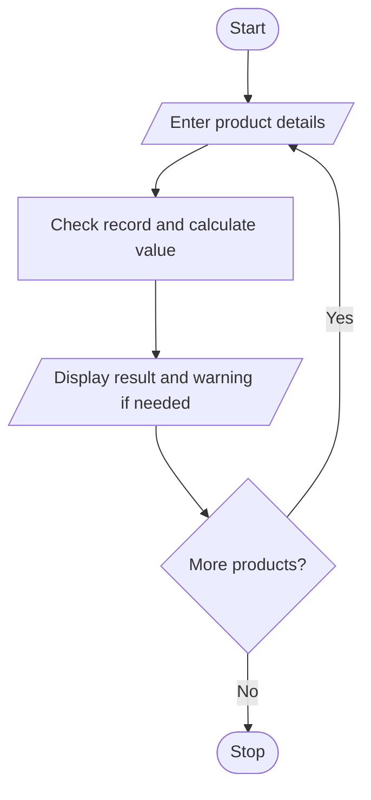

# Problem Statement
write a python program to store product identifiers, prices, and stock quantities in tuples; detect invalid records, calculate inventory values, and identify items requiring replenishment. 

# Algorithm

1. Start
2. Enter product details.
3. Check for negative price or stock.
4. If valid, calculate inventory value and check whether stock is below 5.
5. Display the result.
6. Stop

# Flowchart

# Sample Input

Number of products: 1
Product ID: P01
Price: 10
Stock quantity: 3

# Sample Output

P01 Inventory value: 30.0
Replenishment needed

