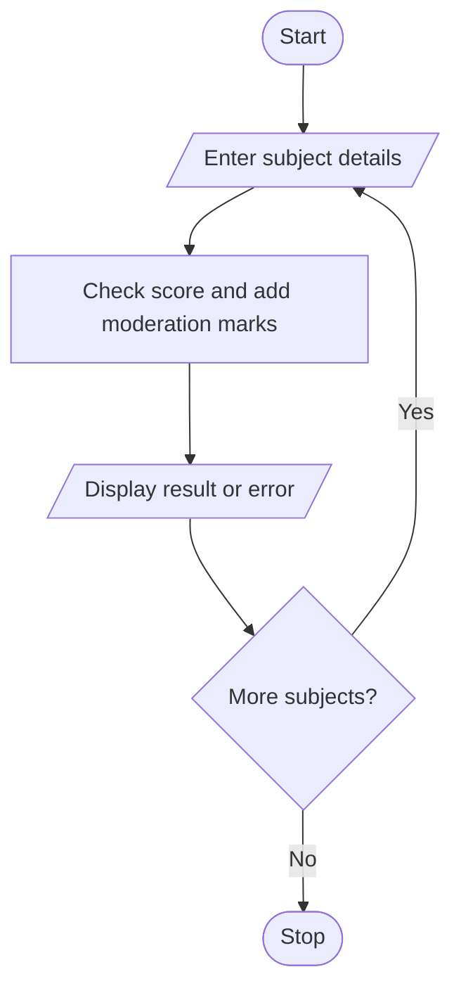

# Problem Statement
Write a python problem to process marks across multiple subjects, apply specified moderation rules, preserve maximum-mark constraints, and compare original and moderated outcomes

# Algorithm

1. Start
2. Enter the number of subjects and moderation marks.
3. Enter each subject and its score.
4. Report invalid scores; otherwise, add moderation marks, capped at 100.
5. Display valid results.
6. Stop

# Flowchart

# Sample Input

Subjects: 1
Moderation marks: 5
Subject: Math
Original mark: 90

# Sample Output

Math Original: 90 Moderated: 95

